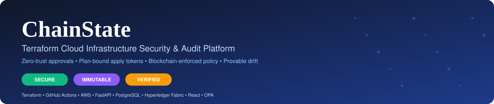
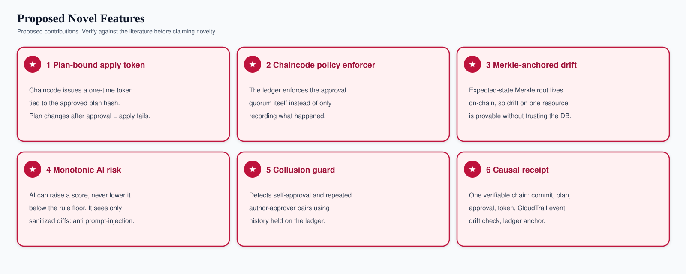
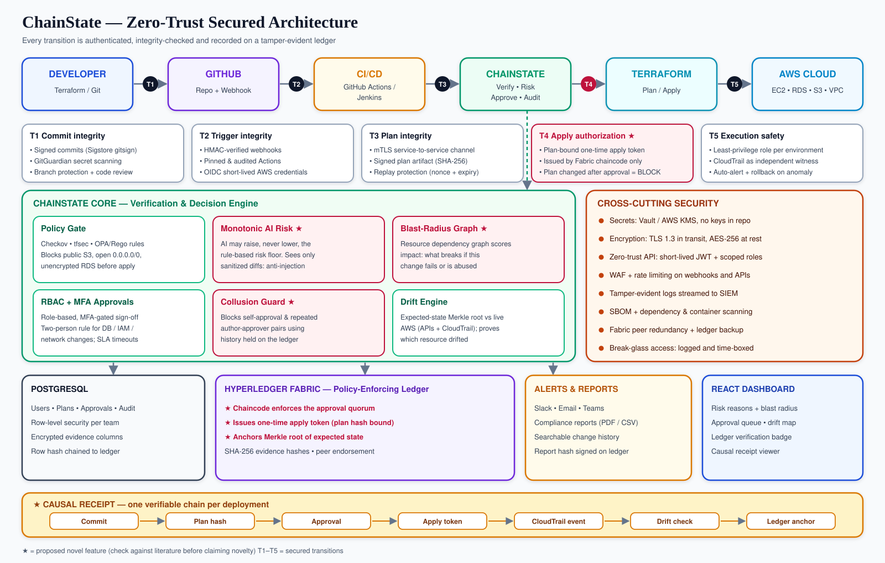
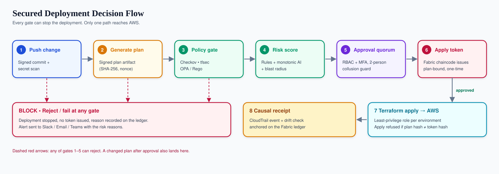
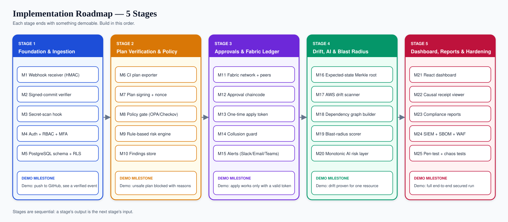

<p align="center">
  
</p>

<p align="center">
  
  
  
  
  
  
  
</p>

> **ChainState** is a security and audit control layer that sits between your Terraform pipeline and your cloud. It verifies every infrastructure change, scores its risk, enforces multi-team approval, detects drift, and records tamper-evident proof on a permissioned blockchain.

---

## Table of Contents

1. [The Problem](#1-the-problem)
2. [What Makes ChainState Different](#2-what-makes-chainstate-different)
3. [Architecture](#3-architecture)
4. [Security at Every Transition](#4-security-at-every-transition)
5. [Deployment Decision Flow](#5-deployment-decision-flow)
6. [Proposed Novel Features](#6-proposed-novel-features)
7. [Implementation Roadmap](#7-implementation-roadmap)
8. [Stage 1: Foundation & Ingestion](#stage-1--foundation--ingestion)
9. [Stage 2: Plan Verification & Policy](#stage-2--plan-verification--policy)
10. [Stage 3: Approvals & Fabric Ledger](#stage-3--approvals--fabric-ledger)
11. [Stage 4: Drift, AI & Blast Radius](#stage-4--drift-ai--blast-radius)
12. [Stage 5: Dashboard, Reports & Hardening](#stage-5--dashboard-reports--hardening)
13. [Tech Stack](#13-tech-stack)
14. [Suggested Repository Layout](#14-suggested-repository-layout)
15. [Data Model](#15-data-model)
16. [API Reference](#16-api-reference)
17. [Getting Started](#17-getting-started)
18. [Testing Strategy](#18-testing-strategy)
19. [Threat Model](#19-threat-model)
20. [Limitations & Future Work](#20-limitations--future-work)
21. [References](#21-references)
22. [Team](#22-team)

---

## 1. The Problem

Teams manage cloud infrastructure through Terraform and CI/CD, but the controls around it are scattered. Security scans, approvals, drift monitoring and audit evidence live in different tools, so risky or unauthorized changes can reach production with no single traceable record.

| Challenge | What goes wrong |
|---|---|
| **Unauthorized changes** | Infrastructure is modified outside the approved Terraform workflow. |
| **Weak traceability** | No reliable link between developer, commit, plan, approval and deployment. |
| **Configuration drift** | The real cloud state diverges from the expected Terraform state. |
| **High-risk changes** | Database, IAM and network changes get the same review as routine edits. |
| **Pipeline as a target** | CI/CD itself can be attacked through stolen keys, tampered actions or replayed approvals. |

**Objective:** build one centralized DevSecOps control layer that verifies Terraform changes, assesses risk, enforces approvals, detects drift, and keeps tamper-evident audit evidence.

---

## 2. What Makes ChainState Different

Most existing work covers one slice of this problem. ChainState combines the slices and adds controls on every hop between them.

| Existing approach (from our literature survey) | Typical gap | ChainState adds |
|---|---|---|
| Terraform scanners (Checkov, tfsec, TFLint, Terrascan) | Scan only. No approval, drift or audit. | Scanning as one gate, followed by approval, token-gated apply, drift and ledger evidence. |
| Blockchain for DevOps / CI-CD (Fabric + Jenkins) | Records events. Not Terraform-state aware. | The ledger **enforces** policy and issues the apply token, not just logs. |
| AI-augmented DevSecOps | Model decides, with no guard against manipulation. | **Monotonic AI risk**: AI can only raise risk, and sees sanitized input. |
| Drift tools | Report drift from a database you must trust. | **Merkle-anchored baseline**: drift is provable per resource. |
| Approval workflows | Approval is a checkbox, detached from what runs. | **Plan-bound one-time apply token**: only the approved plan can run. |

<p align="center">
  
</p>

> **Note on novelty.** These are *proposed* contributions. We could not verify that none has appeared in a paper, so each should be checked against IEEE Xplore and Google Scholar before being claimed as novel.

---

## 3. Architecture

<p align="center">
  
</p>

**Reading the diagram**

- **Top row (T1 to T5):** the delivery pipeline. Each numbered circle is a transition, and the card under it lists the controls on that hop.
- **ChainState Core:** the six engines that decide whether a change may proceed. Red tiles are proposed novel features.
- **Data layer:** PostgreSQL for queries, Hyperledger Fabric for tamper-evident proof, alerts and reports for people, and the React dashboard.
- **Causal receipt:** one chain linking every artifact of a deployment.

---

## 4. Security at Every Transition

| # | Transition | Threat | Controls added |
|---|---|---|---|
| **T1** | Developer to GitHub | Impersonation, leaked secrets, direct pushes | Signed commits (Sigstore gitsign), GitGuardian secret scanning, branch protection, mandatory review |
| **T2** | GitHub to CI/CD | Forged webhooks, poisoned Actions, stolen cloud keys | HMAC-verified webhooks, pinned and audited Actions, OIDC short-lived AWS credentials |
| **T3** | CI/CD to ChainState | Plan tampering, replay of an old approved plan | mTLS, signed plan artifact (SHA-256), nonce + expiry |
| **T4** | Approval to apply | Plan swapped after approval, self-approval, collusion | Plan-bound one-time apply token from chaincode, RBAC + MFA, two-person rule, collusion guard |
| **T5** | Terraform to AWS | Over-privileged pipeline, silent out-of-band change | Least-privilege role per environment, CloudTrail as independent witness, auto-alert and rollback |

**Cross-cutting controls:** Vault / AWS KMS for secrets, TLS 1.3 in transit, AES-256 at rest, short-lived JWT with scoped roles, WAF and rate limiting, SIEM log streaming, SBOM and dependency scanning, Fabric peer redundancy and ledger backup, time-boxed and logged break-glass access.

---

## 5. Deployment Decision Flow

<p align="center">
  
</p>

1. Developer pushes a signed Terraform change. Secret scan runs.
2. CI generates a plan, signs it and attaches a nonce.
3. ChainState runs the policy gate (Checkov, tfsec, OPA).
4. Rule-based risk, blast radius and the monotonic AI layer produce a score and reasons.
5. The approval quorum is collected (RBAC, MFA, two-person rule, collusion guard).
6. Fabric chaincode issues a one-time apply token bound to the plan hash.
7. Terraform apply runs only if the plan hash matches the token. AWS is changed.
8. A causal receipt is anchored on the ledger.

A failure at any of gates 1 to 5, or a plan that changes after approval, blocks the deployment, records the reason, and sends an alert.

---

## 6. Proposed Novel Features

### 6.1 Plan-bound one-time apply token
Approval is cryptographically tied to the exact plan. Chaincode issues a token containing `plan_hash`, `approvers`, `expiry` and `nonce`. The apply step recomputes the plan hash and refuses to run on mismatch. The token is burned on first use, so it cannot be replayed.

### 6.2 Chaincode as policy enforcer
Instead of only recording approvals, the smart contract checks the quorum rules (required teams, minimum approvers, no self-approval) and refuses to issue a token if they are not met. The rule lives where an application-server admin cannot quietly edit it.

### 6.3 Merkle-anchored drift baseline
After each approved apply, the expected state is hashed into a Merkle tree and the **root** is stored on the ledger. During a drift scan, ChainState rebuilds the tree from live AWS state. A differing leaf identifies exactly which resource drifted, and the on-chain root proves what the expected state was.

### 6.4 Monotonic AI risk
The final score is `max(rule_score, ai_score)`. The AI can raise risk but never lower it below the rule-based floor. The model receives only a sanitized plan diff (comments, tags and free-text fields stripped or escaped), which defends against prompt injection through Terraform content.

### 6.5 Collusion guard
The approval graph (author, approver, team, time) is stored on the ledger. Rules reject self-approval, the same author-approver pair approving repeatedly within a window, and approvals that arrive suspiciously fast after submission.

### 6.6 Causal receipt
Each deployment produces one verifiable record linking: commit SHA, plan hash, approval set, apply token ID, CloudTrail event ID, drift-check result and ledger transaction ID. An auditor can verify the whole chain from one page.

---

## 7. Implementation Roadmap

<p align="center">
  
</p>

Build the stages in order. Each ends with a demo you can show, and each stage's output is the next stage's input.

---

## Stage 1 · Foundation & Ingestion

**Goal:** receive GitHub events safely and store them. **Demo:** push to GitHub and see a verified event in the database.

| Module | What it does | How to implement | Security feature |
|---|---|---|---|
| **M1 Webhook receiver** | Accepts GitHub push and pull-request events | FastAPI endpoint `POST /webhooks/github`; read raw body, compute HMAC-SHA256 with the shared secret, compare using `hmac.compare_digest` | Rejects forged or replayed events; rate limited |
| **M2 Signed-commit verifier** | Confirms commits are signed by a known identity | Use GitHub's commit `verification` field and optionally verify Sigstore gitsign certificates | Blocks impersonation |
| **M3 Secret-scan hook** | Stops leaked credentials | Run GitGuardian (`ggshield`) or gitleaks in CI and report the result to ChainState | Fails the pipeline on any secret |
| **M4 Auth + RBAC + MFA** | Logins and roles (developer, reviewer, security, admin) | JWT access tokens (short lifetime) plus refresh; TOTP-based MFA; role check as a FastAPI dependency | Least privilege, MFA for approvers |
| **M5 PostgreSQL schema + RLS** | Stores users, repos, events, plans, approvals, audit | Alembic migrations; enable row-level security so a team sees only its repos | Data isolation per team |

**Exit criteria:** an unsigned or badly signed webhook is rejected, and a valid push creates a row in `events`.

---

## Stage 2 · Plan Verification & Policy

**Goal:** turn a push into a verified, scored Terraform plan. **Demo:** an unsafe plan is blocked with readable reasons.

| Module | What it does | How to implement | Security feature |
|---|---|---|---|
| **M6 CI plan exporter** | Produces the plan in machine-readable form | In GitHub Actions: `terraform plan -out=tfplan` then `terraform show -json tfplan > plan.json` | Runs with OIDC short-lived credentials |
| **M7 Plan signing + nonce** | Makes the plan tamper-evident | Compute SHA-256 of `plan.json`, sign with a CI key (or cosign), attach a nonce and expiry, POST to ChainState over mTLS | Detects modification and replay |
| **M8 Policy gate** | Blocks unsafe configurations | Run Checkov and tfsec, plus OPA/Rego rules over `plan.json` (for example deny public S3, `0.0.0.0/0` on SSH, unencrypted RDS) | Prevents known-bad configs before apply |
| **M9 Rule-based risk engine** | Produces a deterministic risk score | Weighted rules: resource type (IAM, RDS, VPC rank higher), action (delete, replace), environment (prod), size of change | Explainable, reproducible floor for the AI layer |
| **M10 Findings store** | Keeps every finding with its reason | Table `findings(plan_id, rule_id, severity, message)` | Evidence for auditors |

**Exit criteria:** a plan that opens port 22 to the world is rejected, the reasons are listed, and a plan modified after signing fails verification.

---

## Stage 3 · Approvals & Fabric Ledger

**Goal:** make approval binding on what actually runs. **Demo:** `terraform apply` works only with a valid token.

| Module | What it does | How to implement | Security feature |
|---|---|---|---|
| **M11 Fabric network + peers** | Permissioned ledger | Use `fabric-samples/test-network` to start with, then 2 orgs (for example *Dev* and *Security*) with their own peers and an ordering service | Multi-org endorsement, no single owner |
| **M12 Approval chaincode** | Records and validates approvals | Go or Node chaincode: `SubmitApproval`, `GetQuorumStatus`; enforce required teams and minimum approvers inside the contract | Policy enforced on-chain |
| **M13 One-time apply token** | Authorizes exactly one apply | Chaincode function `IssueApplyToken(planHash)` that succeeds only when quorum is met; stores `{planHash, expiry, used:false}`; `ConsumeToken` flips `used` atomically | Plan-bound, expiring, single-use |
| **M14 Collusion guard** | Detects abusive approval patterns | Chaincode checks `author != approver`, pair-frequency within a window, and minimum review time | Stops self-approval and rubber-stamping |
| **M15 Alerts** | Notifies the right people | Slack and Teams incoming webhooks, SMTP email; alert on request, approval, rejection, block | Alerts carry reasons, never secrets |

**Gate in CI:** before `terraform apply`, the pipeline calls ChainState with the plan hash. ChainState consumes the token and returns allow or deny. No token, no apply.

**Exit criteria:** changing one line of the plan after approval makes the apply step fail; reusing a consumed token fails.

---

## Stage 4 · Drift, AI & Blast Radius

**Goal:** detect out-of-band changes and rank risk intelligently. **Demo:** drift is proven for one resource.

| Module | What it does | How to implement | Security feature |
|---|---|---|---|
| **M16 Expected-state Merkle root** | Commits to the approved state | After apply, read the Terraform state, hash each resource (`type+id+canonical attributes`), build a Merkle tree, store the root in chaincode with the receipt | Baseline cannot be edited silently |
| **M17 AWS drift scanner** | Compares live cloud to expected | Scheduled job reads live state with boto3 (EC2, RDS, S3, VPC) and rebuilds the tree; differing leaves are drifted resources; cross-check CloudTrail for who changed it | Provable drift, attributed via CloudTrail |
| **M18 Dependency graph builder** | Models resource relationships | Parse `plan.json` and state into a graph (NetworkX): nodes are resources, edges are references | Basis for impact scoring |
| **M19 Blast-radius scorer** | Estimates what a change can break | Score = number and criticality of reachable dependents (for example an IAM role used by many services ranks high) | Highlights small changes with large impact |
| **M20 Monotonic AI risk layer** | Adds LLM reasoning on top of rules | Sanitize the diff (strip comments and free text, escape tags), prompt the model for reasons and a score, then compute `final = max(rule_score, ai_score)` | Resistant to prompt injection and score lowering |

**Exit criteria:** manually changing a security group in the AWS console is reported as drift on exactly that resource, with the CloudTrail actor attached.

---

## Stage 5 · Dashboard, Reports & Hardening

**Goal:** make it usable, auditable and hard to attack. **Demo:** a full secured run, end to end.

| Module | What it does | How to implement | Security feature |
|---|---|---|---|
| **M21 React dashboard** | Approval queue, risk reasons, drift map | React + Vite, role-aware routes, charts for risk and drift | Role-gated views, ledger-verified badge |
| **M22 Causal receipt viewer** | Shows the full evidence chain | Page that fetches the receipt and re-verifies hashes against the ledger in the browser or API | Independent verification |
| **M23 Compliance reports** | Searchable history and exports | Filter by user, commit, approver, outcome; export PDF/CSV; sign the report hash on the ledger | Reports are themselves tamper-evident |
| **M24 SIEM + SBOM + WAF** | Operational hardening | Ship logs to a SIEM (for example Elastic or Splunk), generate an SBOM (Syft) and scan dependencies and images (Trivy), put a WAF and rate limits in front of the API | Defense in depth |
| **M25 Pen-test + chaos tests** | Proves the controls work | Scripted attacks: forged webhook, plan swap, token replay, self-approval, prompt-injection tags, manual AWS drift | Evidence that each control fires |

**Exit criteria:** every attack in the M25 list is blocked and appears in the audit trail.

---

## 13. Tech Stack

| Layer | Tools |
|---|---|
| **Application** | React (dashboard), Python + FastAPI (APIs), PostgreSQL |
| **DevOps / IaC** | GitHub, GitHub Actions or Jenkins, Terraform |
| **Cloud** | AWS (EC2, RDS, S3, VPC), AWS APIs, CloudTrail, KMS |
| **Security** | Sigstore gitsign, GitGuardian, Checkov, tfsec, OPA/Rego, Vault / KMS, mTLS, SHA-256, RBAC + MFA |
| **AI / Risk** | Rule-based engine, LLM recommendation, human approval for high risk |
| **Blockchain** | Hyperledger Fabric, chaincode (Go or Node), peers and ordering service |
| **Ops** | SIEM, Trivy, Syft (SBOM), WAF |

---

## 14. Suggested Repository Layout

```text
chainstate/
├── backend/                 # FastAPI app
│   ├── app/
│   │   ├── api/             # webhooks, plans, approvals, drift, reports
│   │   ├── core/            # config, auth, RBAC, MFA
│   │   ├── engines/         # policy_gate, risk_rules, blast_radius, ai_risk, drift
│   │   ├── ledger/          # Fabric client (submit/query)
│   │   ├── notify/          # slack, teams, email
│   │   └── db/              # models, alembic migrations
│   └── tests/
├── chaincode/               # Fabric smart contracts
│   └── approval/            # SubmitApproval, IssueApplyToken, ConsumeToken, SaveMerkleRoot
├── policies/                # OPA/Rego rules
├── ci/                      # GitHub Actions / Jenkins pipelines
├── frontend/                # React dashboard
├── infra/                   # Terraform for demo AWS + docker-compose for Fabric
├── attacks/                 # M25 attack scripts
├── assets/                  # README diagrams
└── README.md
```

---

## 15. Data Model

```text
users(id, email, role, team, mfa_secret_enc)
repos(id, name, team)
events(id, repo_id, commit_sha, author, signed_ok, received_at)
plans(id, event_id, plan_hash, signature, nonce, expires_at, risk_score, status)
findings(id, plan_id, rule_id, severity, message)
approvals(id, plan_id, approver_id, decision, comment, decided_at)
apply_tokens(id, plan_id, token_id, used, issued_at)   -- mirrored from ledger
drift_scans(id, repo_id, merkle_root, drifted_resources, scanned_at)
receipts(id, plan_id, commit_sha, plan_hash, token_id, cloudtrail_event_id, ledger_tx_id)
audit_log(id, actor, action, subject, hash, prev_hash, ts)   -- hash-chained
```

---

## 16. API Reference

| Method | Endpoint | Purpose |
|---|---|---|
| `POST` | `/webhooks/github` | Receive and verify GitHub events |
| `POST` | `/plans` | Submit a signed plan for verification |
| `GET` | `/plans/{id}` | Plan status, risk score and findings |
| `POST` | `/plans/{id}/approve` | Approve or reject (RBAC + MFA) |
| `POST` | `/plans/{id}/apply-check` | CI asks to apply; consumes the one-time token |
| `GET` | `/drift/{repo}` | Latest drift result |
| `POST` | `/drift/{repo}/scan` | Trigger a drift scan |
| `GET` | `/receipts/{plan_id}` | Causal receipt with verification status |
| `GET` | `/reports` | Searchable history and export |

---

## 17. Getting Started

> Prerequisites: Docker, Python 3.11+, Node 20+, Terraform, an AWS sandbox account, a GitHub repo for testing.

```bash
# 1. clone
git clone https://github.com/<your-username>/chainstate.git
cd chainstate

# 2. configuration
cp .env.example .env        # set DB url, GitHub webhook secret, JWT secret, Slack/SMTP

# 3. database
docker compose up -d postgres
cd backend && pip install -r requirements.txt
alembic upgrade head

# 4. Fabric test network + chaincode
cd ../infra/fabric && ./network.sh up createChannel -c chainstate
./network.sh deployCC -ccn approval -ccp ../../chaincode/approval -ccl go

# 5. run backend and frontend
cd ../../backend && uvicorn app.main:app --reload
cd ../frontend && npm install && npm run dev
```

Then add a GitHub webhook pointing at `/webhooks/github` (content type `application/json`, same secret as `.env`) and copy `ci/chainstate.yml` into your repo's `.github/workflows/`.

---

## 18. Testing Strategy

| Level | What to test |
|---|---|
| **Unit** | HMAC check, plan hash, Merkle tree, risk formula (`final >= rule_score` always) |
| **Integration** | Webhook to plan to approval to token to apply, against a Fabric test network |
| **Security** | Forged webhook, modified plan, replayed token, self-approval, prompt-injection in tags, manual AWS drift |
| **Property tests** | Monotonic AI never lowers risk; token usable once; Merkle root changes when any resource changes |
| **Performance** | Plan verification latency, ledger write latency, drift scan time vs. number of resources |

---

## 19. Threat Model

| Threat (STRIDE) | Example | Mitigation |
|---|---|---|
| Spoofing | Fake webhook or commit author | HMAC, signed commits |
| Tampering | Plan edited after review | Signed plan, plan-bound token |
| Repudiation | "I never approved that" | Ledger-anchored approvals, causal receipt |
| Information disclosure | Keys in repo or logs | Secret scanning, Vault/KMS, redacted alerts |
| Denial of service | Webhook flood | WAF, rate limiting, queueing |
| Elevation of privilege | Pipeline role used for other environments | Least-privilege role per environment, OIDC |
| AI-specific | Prompt injection via Terraform comments | Sanitized input, monotonic scoring, human approval for high risk |

---

## 20. Limitations & Future Work

- The causal receipt trusts CloudTrail as the independent witness, so CloudTrail itself must be protected (separate account, log validation).
- Fabric gives tamper evidence among the participating organizations. It does not stop a majority of orgs from colluding.
- The AI layer can only raise scores. It cannot catch a risk the rules and model both miss, which is why high-risk changes keep human approval.
- Future: support for OpenTofu, Pulumi and multi-cloud, policy-as-code marketplace, formal verification of the chaincode rules.

---

## 21. References

1. R. Singh, A. Yeboah-Ofori, S. Kumar, A. Ganiyu, "Fortifying Cloud DevSecOps Security Using Terraform Infrastructure as Code Analysis Tools," ICECER, 2024. DOI: 10.1109/ICECER62944.2024.10920371
2. J. N. Qureshi, M. S. Farooq, U. Ali, A. Khelifi, Z. Atal, "Exploring the Integration of Blockchain and Distributed DevOps for Secure, Transparent, and Traceable Software Development," IEEE Access, 2024. DOI: 10.1109/ACCESS.2024.3509036
3. S. M. Saleh, N. Madhavji, J. Steinbacher, "Towards a Blockchain-Based CI/CD Framework to Enhance Security in Cloud Environments," 2024 7th Conference on Cloud and Internet of Things (CIoT), IEEE.
4. A. Mittal, "AI-Augmented DevSecOps Pipelines for Secure and Scalable Service-Oriented Architectures in Cloud-Native Systems," 2025 IEEE International Conference on Service-Oriented System Engineering (SOSE).
5. S. Bhatia, M. Shafiq, "Machine Learning-Based DevSecOps for Cloud Applications," IEEE Access, vol. 10, pp. 87643-87655, 2022.

---

## 22. Team

**Capstone-I Project, CSE-Allied Department**

| Member | Role |
|---|---|
| Danthoju Sai Vamshi | Team member |
| Gunda Tejeswara Rao | Team member |

**Faculty Guide:** P. Phani Prasad, Assistant Professor

<p align="center"><sub>If this project helps you, please star the repo.</sub></p>
